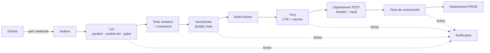
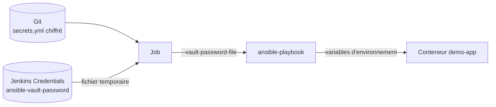

# TP02 – Usine logicielle CI/CD & DevSecOps

Chaîne complète : **GitHub → Jenkins → Lint → SonarQube → Docker → Trivy → Déploiement TEST → Tests de connectivité → Déploiement PROD**, avec des secrets protégés par **Ansible Vault**.
Une étape obligatoire en échec **bloque automatiquement** tout déploiement et déclenche une notification.

## 1. Architecture



Tout tourne dans le réseau Docker `tp02-cicd-net` : Jenkins joint SonarQube via `http://sonarqube:9000` et les applications déployées via `demo-app-test:5000` / `demo-app-prod:5000`. Jenkins pilote le démon Docker de l'hôte par `/var/run/docker.sock`.

## 2. Arborescence

```
TP02-CICD-DEVSECOPS/
├── docker-compose.yml          Jenkins + SonarQube + PostgreSQL
├── Jenkinsfile                 Pipeline déclaratif
├── jenkins/
│   ├── Dockerfile              Jenkins + docker CLI, Trivy, sonar-scanner, ansible, linters
│   ├── plugins.txt             Plugins installés au build de l'image
│   └── requirements-ci.txt     Outils Python (venv /opt/venv)
├── sonarqube/sonar-project.properties
├── trivy/
│   ├── scan.sh                 Scan + politique de validation (exit codes)
│   └── .trivyignore            Risques acceptés (vide par défaut)
├── vault/
│   ├── secrets.yml             Variables sensibles CHIFFRÉES (Ansible Vault)
│   └── secrets.example.yml     Modèle en clair, sans aucun secret
├── scripts/
│   ├── setup.sh                Vérifie les prérequis, génère .env
│   ├── vault.sh                init | encrypt | edit | view | rekey
│   ├── lint.sh                 yamllint | ansible-lint | pylint | vault-check
│   ├── run-tests.sh            pytest + couverture (pour SonarQube)
│   ├── deploy.yml              Playbook de déploiement (test / prod)
│   ├── connectivity-test.sh    Tests de connectivité
│   └── notify.sh               Notification webhook + journal
├── app/                        Application de démonstration (Flask)
├── reports/                    Rapports générés (archivés par Jenkins)
├── .env.example · .gitignore · .yamllint · .ansible-lint · .pylintrc · pytest.ini · .coveragerc · ansible.cfg
└── README.md
```

## 3. Prérequis

- Docker Engine ≥ 24 + plugin Compose v2, 6 Go de RAM disponibles.
- Linux (ou WSL2). SonarQube exige `vm.max_map_count ≥ 262144` sur l'hôte Docker.
- Un compte GitHub et un dépôt dont **la racine est ce dossier**.

```bash
bash scripts/setup.sh          # contrôle les prérequis, crée .env (mot de passe BDD aléatoire, DOCKER_GID)
sudo sysctl -w vm.max_map_count=262144     # si le script l'indique
```

## 4. Étape 1 – Jenkins

```bash
docker compose up -d --build   # premier build : plusieurs minutes (Trivy, scanner, ansible, plugins)
docker compose ps              # attendre « healthy »
docker exec jenkins cat /var/jenkins_home/secrets/initialAdminPassword
```

1. Ouvrir <http://localhost:8080>, saisir le mot de passe initial, choisir **Install suggested plugins** (les plugins de `jenkins/plugins.txt` sont déjà intégrés à l'image), créer l'administrateur.
2. **Credentials** (Manage Jenkins → Credentials → Global) :

| ID | Type | Contenu |
|---|---|---|
| `sonar-token` | Secret text | Jeton SonarQube (étape 2) |
| `ansible-vault-password` | **Secret file** | Fichier contenant le mot de passe du vault (étape 4) |
| `notify-webhook-url` | Secret text | URL d'un webhook Slack/Discord/Teams (optionnel) |
| `github-pat` | Username with password | Utilisateur GitHub + Personal Access Token (dépôt privé uniquement) |

3. **Connexion à GitHub** : créer le job *New Item → Pipeline* → *Pipeline script from SCM* → Git → URL du dépôt (+ credential `github-pat` si privé) → branche `*/main` → Script Path `Jenkinsfile`.
   - Déclenchement : le `Jenkinsfile` interroge Git toutes les ~5 min (`pollSCM`). Pour un déclenchement immédiat, ajouter un webhook GitHub `https://<URL publique>/github-webhook/` (JSON, événement *push*) via un tunnel (ngrok, smee.io…) puis cocher *GitHub hook trigger for GITScm polling*.
4. Le déploiement PROD ne s'exécute que sur la branche `main`.

## 5. Étape 2 – SonarQube

1. <http://localhost:9000> → `admin` / `admin` → changer le mot de passe.
2. *My Account → Security → Generate Tokens* (type **User token**) → copier le jeton dans Jenkins (`sonar-token`).
3. Jenkins → *Manage Jenkins → System → SonarQube servers* → **Add** : Name `SonarQube` (nom utilisé par le Jenkinsfile), URL `http://sonarqube:9000`, token `sonar-token`.
4. Première analyse : lancer le job. Le projet `tp02-demo-app` est créé automatiquement. Le scanner attend le **Quality Gate** (`sonar.qualitygate.wait=true`) et renvoie une erreur s'il échoue : c'est ce qui bloque le pipeline, sans webhook à configurer.
5. Résultats : <http://localhost:9000/dashboard?id=tp02-demo-app>.

> Le Quality Gate par défaut (« Sonar way ») exige 80 % de couverture sur le nouveau code : c'est pourquoi le pipeline exécute `pytest --cov` avant l'analyse.

## 6. Étape 3 – Trivy

Trivy est installé dans l'image Jenkins (version fixée par `TRIVY_VERSION`). Scan manuel :

```bash
docker exec -it jenkins trivy image --severity HIGH,CRITICAL --ignore-unfixed demo-app:latest
docker exec -it jenkins bash -lc 'cd /var/jenkins_home/workspace/<job> && bash trivy/scan.sh demo-app:latest'
```

**Lire une CVE** : `VulnerabilityID` (CVE-AAAA-NNNN), `PkgName` + `InstalledVersion` (composant touché), `FixedVersion` (version corrigée → correction = mise à jour), `Severity` (CRITICAL > HIGH > MEDIUM > LOW), lien NVD/avd.aquasec.com.

**Conditions de validation de sécurité** (`trivy/scan.sh`, ajustables par variables d'environnement) :

| Constat | Décision | Code de sortie | Effet Jenkins |
|---|---|---|---|
| ≥ 1 CVE **CRITICAL** corrigeable | **Bloquant** | 1 | Build en échec, rien n'est déployé |
| ≥ 1 **secret** dans l'image | **Bloquant** | 1 | Build en échec |
| CVE **HIGH** corrigeables, aucune CRITICAL | Avertissement | 2 | Build `UNSTABLE`, déploiement possible + notification |
| Aucun constat | Validé | 0 | OK |
| Trivy ne s'exécute pas (base CVE, image absente) | **Fail closed** | 3 | Build en échec |

- Les CVE sans correctif publié sont ignorées (`IGNORE_UNFIXED=true`) : on ne peut pas les corriger, mais elles restent dans le rapport JSON.
- Durcir la politique : `BLOCK_SEVERITIES=CRITICAL,HIGH` (variable `environment` du Jenkinsfile).
- Accepter un risque : ligne dans `trivy/.trivyignore` **avec date d'expiration** (`CVE-XXXX-YYYY exp:2027-01-31`) et justification en commentaire.
- Rapports : `reports/trivy/trivy-report.{json,html,txt}` + `summary.txt`.

## 7. Étape 4 – Secrets (Ansible Vault)

**Principe** : aucun secret en clair dans Git. `vault/secrets.yml` est chiffré (AES256) ; le mot de passe du vault n'est jamais commité.



- **Fourni** : `vault/secrets.yml` est chiffré avec le mot de passe de **démonstration** `tp02-demo-only-change-me`.
  Ne publiez jamais un dépôt avec ce mot de passe : **générez le vôtre avant le premier `git push`** :

```bash
bash scripts/vault.sh init     # crée .vault_pass (aléatoire, ignoré par Git) + régénère secrets.yml chiffré avec des secrets aléatoires
bash scripts/vault.sh view     # lecture
bash scripts/vault.sh edit     # modification
bash scripts/vault.sh rekey    # changement du mot de passe
```

- Puis créer dans Jenkins le credential **Secret file** `ansible-vault-password` en téléversant `.vault_pass`.
- Garde-fous : `.gitignore` (`.env`, `.vault_pass`), étape `vault encrypted?` du lint (échec si `secrets.yml` est en clair), `no_log: true` sur les tâches Ansible qui manipulent les secrets, secrets Jenkins masqués dans les logs, le fichier mot de passe n'existe que le temps de l'étape (`withCredentials`).
- Les secrets de l'infrastructure (`.env` : mot de passe PostgreSQL) restent sur l'hôte, hors Git.

## 8. Étape 5 – Le pipeline

| # | Stage | Outil | Bloquant si… |
|---|---|---|---|
| 1 | Checkout Git | `checkout scm` | dépôt inaccessible |
| 2 | Lint (en parallèle) | yamllint · ansible-lint · pylint · contrôle vault chiffré | une anomalie |
| 2b | Tests unitaires | pytest + couverture ≥ 80 % | un test échoue |
| 3 | SonarQube Scan | sonar-scanner + Quality Gate | Quality Gate en échec |
| 4 | Build Docker | `docker build` | build impossible |
| 5 | Trivy Scan | `trivy/scan.sh` | voir §6 |
| 6 | Deploy TEST | Ansible + Vault | échec du playbook |
| 7 | Tests de connectivité | `connectivity-test.sh` | TCP, `/health`, secrets injectés, 404, latence |
| 8 | Deploy PROD | Ansible + Vault + smoke test | branche ≠ `main`, échec, approbation refusée |
| – | Post | archivage des rapports, **notification** | sur `FAILURE` et `UNSTABLE` |

Paramètres du job : `SIMULATE_VULNERABILITY` (construit l'image avec Django 2.2.0, vulnérable), `REQUIRE_APPROVAL` (validation manuelle avant la PROD).
Notification : webhook Slack/Discord/Teams si `notify-webhook-url` existe, sinon trace dans `reports/notifications.log`.

## 9. Validation du TP

**A – Nominal.** Lancer le job : tous les stages verts. Vérifier :
```bash
curl -s localhost:8081/health   # TEST
curl -s localhost:8082/health   # PROD   → {"secrets_loaded":true,"status":"ok",...}
```
Consulter SonarQube (Quality Gate *Passed*) et, dans le build, *Trivy Report* + artefacts `reports/`.

**B – Lint.** Ajouter `import os` inutilisé dans `app/demo_app/main.py` (ou casser l'indentation d'un YAML) → stage Lint rouge, rien d'autre ne s'exécute.

**C – SonarQube.** Ajouter `PASSWORD = "Admin123!"` dans `main.py` → Quality Gate en échec (secret en dur) → build rouge, pas d'image, pas de déploiement.

**D – Trivy.** *Build with Parameters* → `SIMULATE_VULNERABILITY=true` → stage 5 rouge (`SECURITY GATE: BLOCKED`, liste des CVE CRITICAL), **les stages 6 à 8 ne s'exécutent pas**, notification envoyée.

**E – Secrets.** Remplacer `secrets.yml` par une version en clair → stage `vault encrypted?` rouge. Ou fournir un mauvais mot de passe au credential → échec du déploiement.

**F – Connectivité.** Retirer `API_TOKEN` de `env` dans `deploy.yml` → `secrets_loaded != true` → échec des tests TEST, PROD jamais déployée.

Capturer pour le compte rendu : pipeline vert, dashboard SonarQube, rapport Trivy, un run bloqué par Trivy, la notification.

## 10. Dépannage

| Symptôme | Cause / correctif |
|---|---|
| SonarQube redémarre en boucle | `sudo sysctl -w vm.max_map_count=262144` |
| `permission denied … docker.sock` dans Jenkins | `DOCKER_GID` de `.env` ≠ groupe du socket (`stat -c %g /var/run/docker.sock`), puis `docker compose up -d` |
| Docker Desktop (Mac/Windows) : socket inaccessible | ajouter `user: root` au service `jenkins` (simplification de TP) |
| `Could not find credentials entry` | ID de credential différent de ceux du §4 |
| `No such installation 'SonarQube'` | nom du serveur SonarQube dans Jenkins ≠ `SonarQube` |
| Quality Gate échoue sur la couverture | vérifier `reports/coverage.xml` et `sonar.python.coverage.reportPaths` |
| Trivy : exit 3 | pas d'accès à ghcr.io (base CVE) ou image absente ; relancer, vérifier le réseau |
| Stage PROD « skipped » | la branche n'est pas `main` |

## 11. Limites et sécurité

- Monter `/var/run/docker.sock` équivaut à donner un accès root à l'hôte : acceptable pour un TP, à proscrire en production (agents dédiés, rootless, socket proxy).
- Les versions des outils de `jenkins/requirements-ci.txt` ne sont pas figées : à épingler pour des builds reproductibles.
- Pistes d'amélioration : rollback automatique de la PROD, Jenkins Configuration as Code, registre d'images privé, signature d'images (cosign), SBOM.

## 12. Intégration avec le TP 01

Dans `scripts/deploy.yml`, remplacer `hosts: localhost` par le groupe d'hôtes de l'inventaire du TP 01, ajouter un credential SSH Jenkins (`sshagent`) et remplacer les modules `community.docker` par les rôles du TP 01. Le pipeline, les contrôles qualité/sécurité, le vault et les tests de connectivité restent identiques.
# TP02-CICD-DEVSECOPS
